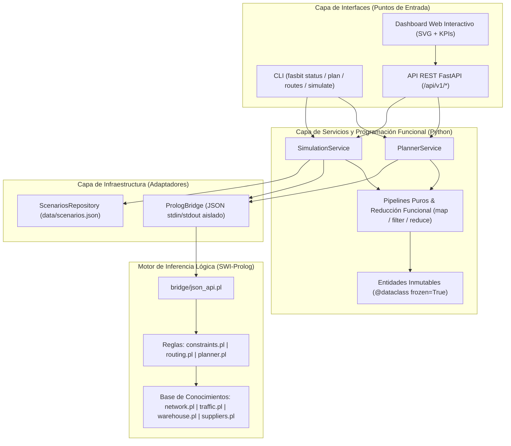

# Arquitectura del Sistema FASBIT

## 1. Visión Arquitectónica

**FASBIT** implementa una **Arquitectura Limpia / Hexagonal Híbrida** que desacopla estrictamente el **Motor de Inferencia Lógica (SWI-Prolog)** de la **Capa Funcional y de Orquestación (Python)**, permitiendo incorporar nuevas reglas de negocio, nodos viales, restricciones de almacén o interfaces gráficas sin reestructurar el sistema.

## 2. Trazabilidad con las Restricciones del Documento (UTP - Avance 1)

| Restricción / Objetivo del Documento | Módulo Responsable | Mecanismo Implementado |
| :--- | :--- | :--- |
| **Mapeo de ubicaciones y rutas de proveedores** | `prolog/knowledge_base/network.pl` | Grafo dirigido de ubicaciones de origen, intersecciones viales y almacén central con distancia, tiempo base y costo. |
| **Impacto del tráfico y horarios de llegada** | `prolog/knowledge_base/traffic.pl` + `routing.pl` | Clasificación automática de franjas horarias (hora punta / valle / nocturno), factores multiplicadores de tiempo/combustible y overrides dinámicos. |
| **Cumplimiento de plazos y multas** | `prolog/rules/constraints.pl` | Regla `evaluar_cumplimiento_plazo/8` que contrasta llegada real contra ventana de recepción y plazo máximo. |
| **Posicionamiento correcto en zonas de entrega** | `prolog/knowledge_base/warehouse.pl` + `planner.pl` | Validación de compatibilidad entre categoría de producto y muelle (`zona_valida_entrega/3`), corrigiendo errores operativos del proveedor. |
| **Prevención de colapsos en zonas de recepción** | `prolog/rules/planner.pl` | Control de intervalos solapados (`intervalos_solapados/4`) y capacidad simultánea de vehículos; desvía a muelles auxiliares compatibles o escalona turnos. |
| **Control de stock y capacidad de almacenamiento** | `prolog/rules/constraints.pl` | Priorización P1 de productos bajo el stock mínimo de seguridad (evita quiebres) y recorte automático al tope físico del almacén (evita sobrealmacenamiento). |
| **Evaluación mediante escenarios simulados** | `src/fasbit/services/simulation_service.py` + `functional/metrics.py` | Comparación cuantitativa entre comportamiento habitual sin planificador y operación optimizada con FASBIT en 4 escenarios. |

## 3. Escalabilidad del Diseño

1. **Extensión declarativa de la red vial**: Agregar nuevas carreteras, peajes o sedes de proveedores solo requiere añadir hechos `ubicacion/5` y `tramo/5` en `prolog/knowledge_base/network.pl`.
2. **Nuevas reglas de negocio sin efectos colaterales**: Las restricciones están separadas en `prolog/rules/constraints.pl`; agregar restricciones de peso por eje o cadena de frío estricta no altera el puente Python ni la interfaz REST.
3. **Aislamiento de estado por consulta**: `PrologBridge` ejecuta cada evaluación sobre un proceso limpio con comunicación JSON en UTF-8, permitiendo concurrencia segura en entornos web o microservicios.
4. **Inmutabilidad en Python**: Todos los modelos de dominio usan `frozen=True` y tuplas inmutables procesadas con funciones puras (`pipe`, `compose`, `reduce`), facilitando pruebas deterministas y paralelización futura.

